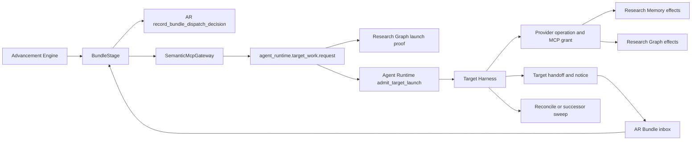
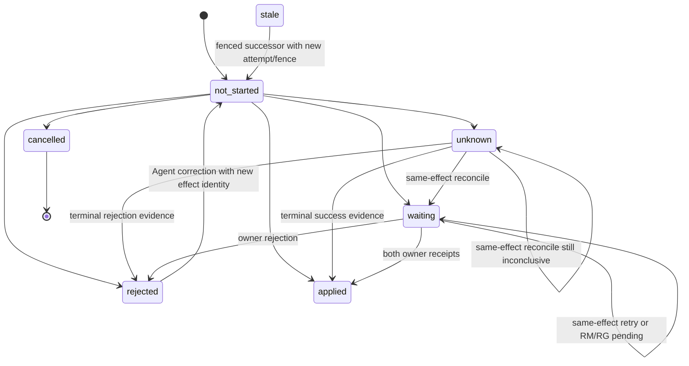

# 全系统统一异常契约

本次工作基于 `v1-test` HEAD `7042bcc`。当前工作区原有的未提交改动保留在另一个 checkout 中。本文件记录真实基线、实验结论、已实施的全系统边界和仍未覆盖的风险。核心证明路径仍是 Bundle 到 Target 再回到 Bundle。

## 基线调用图

后台边界位于 AR inbox、Harness reconcile loop 和 successor reservation。AR 持有 stage run、attempt、fence、target launch、handoff 和 inbox checkpoint。RG 校验 Target graph 与 launch request。RM 持有内容和结果版本。`Database.fenced_write` 在 currentness read 之前取得 SQLite writer。

## Effect 盘点

| Effect | 输入身份 | 成功状态 | 主要错误来源 | 当前处理 |
| --- | --- | --- | --- | --- |
| Bundle dispatch decision | run、attempt、fence、frontier、inbox checkpoint | dispatch decision receipt | stale checkpoint、stale fence、provider contract | AR generation CAS，旧提交拒绝 |
| `agent_runtime.target_work.request` | `effect_id`、Target ref、dispatch decision ref、可选 waiter authorization | `effect_confirmed`、`operation_ref` | RG graph rejection、authorization、Owner conflict、stale fence | effect/reconcile pair，unknown 时要求原 effect reconcile |
| Target Harness turn | run、attempt、native session、fence、provider operation | sealed terminal evidence | timeout、response loss、process restart、native session failure | exact operation reconcile，必要时 successor |
| RM result write | result manifest、effect identity、fence | RM acceptance receipt | idempotency conflict、persistence failure、old fence | Owner authority，same effect replay |
| RG handoff | target completion、RM receipts、attempt/fence | TargetCommit or rejection receipt | missing RM/RG half handoff、semantic rejection | handoff remains waiting until both owners prove |
| Bundle inbox consume | notice、handoff manifest、checkpoint | Bundle consumes notice | cursor/checkpoint conflict、missing terminal proof | inbox CAS and re-read |

idea、plan、reasoning 共享 stage attempt and runtime binding。deepfetch 和 acquisition 已有 durable request/effect/reconcile。它们只需要共享 gateway projection，不能把 attempt-independent effect key 改成 attempt-bound key。

## 全系统边界覆盖

| 系统边界 | 统一处理 | 仍保留的本地事实 |
| --- | --- | --- |
| Idea、Plan、Reasoning stage provider | 通过 Agent Runtime 和 Semantic MCP 进入同一映射，保留 attempt、fence、native session 和 provider job identity | 各 stage 的科学候选、拒绝原因和 checkpoint |
| DeepFetch、Acquisition、Research Asset | 通过已有 request、effect、reconcile 记录投影异常，未知结果要求原 effect 查询 | 下载、浏览器会话和来源证据的 Owner 状态 |
| Bundle、Target、RM、RG | 交接和写入使用同一 effect、handoff、waiting、unknown、stale 语义 | AR、RM、RG 各自的状态权威和 fenced write |
| External MCP | JSON-RPC `error.data.error_contract` 附加统一投影，provider code 和原始诊断继续返回 | 外部服务的 provider diagnostics 和配置快照 |
| HTTP、CLI、Harness | 返回统一投影并保留旧 `code`、`status`、`reason` 和 exception code | 旧客户端的 wire shape 和本地命令错误 |
| DurableFeed、daemon、replay | effect 错误按 `audit_ref` 去重，重启后从 DurableFeed 读取 | worker health 的既有字符串字段和 daemon 的本地生命周期事件 |

## 统一异常契约

`src/meta_research/error_contract.py` 定义 `ErrorContract`。它包含稳定 `stable_code`、兼容 `legacy_code`、`phase`、`operation_id`、`operation_ref`、`effect_id`、`effect_status`、`field_path`、`handoff`、`expected`、`actual`、StageAgent 反馈、修复指令、重试与 reconcile 策略、`next_action`、resume、successor、Operator 路由、recovery owner、audit 和 correlation 标识。MCP 顶层仍返回 legacy code，details 同时暴露 stable code。

`effect_status` 只有 `not_started`、`applied`、`waiting`、`rejected`、`unknown`、`stale`、`cancelled`。`unknown` 默认禁止重试并要求同一 effect reconcile。`stale` 禁止写入。Agent correction 从 `rejected` 回到 `not_started` 时要求新 effect identity。`unknown` 没有 terminal evidence 不能转为 `applied`。

`SemanticMcpGateway` 现在把 schema mismatch、effect operation 的 capability rejection、Owner `SemanticMcpError`、unexpected handler failure 和 output mismatch 转换为该契约。未授权的只读 operation 和 channel auth 继续保持原有 wire shape，避免破坏现有 MCP callers。相同 code 在契约 registry 中仍按 Operator 路由。原有 code 保留在 `legacy_code`，原有 `details` 字段继续可读。`operation_ref` 和 `correlation_ref` 由 run、root session、phase、operation 和 effect identity 稳定派生。

旧 stage adapter 如果返回 `not_applied` 或 `not_recorded`，会保留旧的 `effect_status`，并额外提供 canonical `normalized_effect_status`。Target-work vertical slice 直接输出 canonical `effect_status`。

共享内核负责状态、路由、身份和安全投影。Bundle adapter 负责 handoff 与 notice 字段。Target/Harness adapter 负责 native session、reconcile 和 successor 证据。RM/RG 继续由各自 Owner 接纳与拒绝。

## 状态转移

## 三类异常路由

| 类别 | 例子 | 路由 | 约束 |
| --- | --- | --- | --- |
| Agent 可修复 | schema、Target definition、context binding、scientific handoff | StageAgent | 修复字段或上下文后用新 effect identity 提交 |
| 系统自动恢复 | response loss、短暂 dependency failure、timeout、restart、native resume、RM/RG pending | System | 保留 unknown 或 waiting，使用同一 effect reconcile，禁止盲重试 |
| 系统缺陷或运维 | old fence 被接受、状态机损坏、持久化读回失败、审计缺失、recovery proof 不足 | Operator | 不反馈 StageAgent，保留 operator_required 和 audit/correlation |

权限错误按边界处理。未持有 MCP grant 的请求是 `rejected` 并要求 Operator。已经进入 operation 但被业务授权拒绝的请求（如业务级 `*_unauthorized`）保留 legacy code 并固定路由为 `recovery_owner="agent"`、`effect_status="rejected"`、`retry_allowed=false`，直接反馈给 StageAgent 而非按 `unknown` 要求 reconcile；涉及运行时绑定/安全的 `*_runtime_binding_unauthorized` 则继续保留系统侧路由。此外，只读 operation（`effect=false`）在参数校验和 handler 阶段失败时均跳过 `ErrorAuditStore` 写锁持久化（`audit_ref=null`、`audit_status="skipped_read_only"`），仅对 effect 写入及变更边界保留审计落盘，避免只读报错争抢 SQLite 写锁。

## Bundle 到 Target 再回到 Bundle 的实施计划

1. 共享内核先定义错误身份、effect 状态、路由和转移守卫。`error_contract.py` 不拥有业务状态。
2. Semantic MCP 和 Owner composition 再接入统一映射和 `ErrorAuditStore`。旧的只读 capability 和 auth 响应保持原格式。
3. External MCP、Harness、HTTP 和 CLI 增加薄 adapter。Bundle、Target、RM、RG 继续使用现有 attempt、fence、handoff、inbox 和 reconcile 记录。
4. 临时故障注入先验证响应丢失、RM/RG 半交接、重启、native successor、旧 fence 和 Agent correction。随后跑本地 contract、gateway、审计和远端边界回归。
5. 最后用真实 A100 探针完成 Quest initialization 到 Cycle activation，并把远端环境、GPU、DurableFeed 和持久 Cycle 状态保存为证据。

## 实验与故障注入

实验只使用临时 SQLite 和临时脚本，没有修改生产源码。可重跑的脚本和输出保存在 `.audit/unified-error-prototype.py`、`.audit/unified-error-prototype.json`、`.audit/unified-error-edge-cases.py` 和 `.audit/unified-error-edge-cases.json`。

实验观察到 Owner 写入后响应丢失仍能在重启后读到 `applied`。RM 写入而 RG 未写入时状态为 `waiting`，同一 effect reconcile 后 RM 写入次数仍为 1。unknown 重启后仍为 unknown，盲重试被阻断。旧 fence 在提交前、恢复期间和提交后都被拒绝。native resume 失败后 successor 获得新 attempt/fence。Agent correction 使用新 effect identity。审计行能重建 effect、phase 和 fence lineage。

## 修改文件

- `src/meta_research/error_contract.py` 定义共享契约、路由、投影和转移守卫。
- `src/meta_research/semantic_mcp.py` 生成 operation/correlation identity，并在 MCP 错误边界投影统一契约。
- `tests/test_unified_error_contract.py` 覆盖状态守卫、路由、脱敏和 legacy code。
- `tests/test_unified_error_gateway.py` 覆盖真实 `SemanticMcpGateway` 的参数错误、handler unknown、same-effect reconcile 指令和缺失 grant。
- `.audit/unified-error-*` 保存计划、决策、实验脚本和实验结果。

没有修改 root stage 科学逻辑、RM/RG Owner 接纳算法、idea、plan、reasoning、deepfetch、acquisition 或数据库迁移。`ErrorAuditStore` 复用现有 `durable_feed` 和 `projection_offsets`，所以这轮不需要新增迁移。CLI、HTTP、External MCP、Harness 和 runtime composition 已增加薄 adapter。daemon 和 Owner 的既有恢复算法保持不变。

`ErrorAuditStore` 使用现有 DurableFeed 记录 `system.error_contract`。`audit_ref` 重复提交会读回原记录，payload 变化会产生 `error_audit_idempotency_conflict`。它没有创建第二个状态权威。

| 边界 | 统一投影 | 兼容处理 |
| --- | --- | --- |
| Semantic MCP | `ErrorContract`、operation/correlation ref、DurableFeed audit | 只读 capability 和 channel auth 保留旧 wire shape |
| HTTP | `detail.error_contract` | 旧 `detail.code` 保留 |
| CLI JSON | `error_contract` | `status` 与 `reason` 保留 |
| External MCP | JSON-RPC `error.data.error_contract` | 原 provider code 保留 |
| Harness | admission/harness error adapter | 原 exception code 保留 |
| Owner composition | 共享 `ErrorAuditStore` 注入 gateway | Owner 仍是状态权威 |

## 验证结果

直接的模块检查通过。`python -m py_compile` 对 `error_contract.py` 和 `semantic_mcp.py` 通过。Python 3.10 下的手工契约和 gateway 脚本通过，覆盖未知状态、stale fence、schema error、handler failure 和 auth failure。

在没有加载仓库全局 `tests/conftest.py` 的隔离目录中，契约、gateway、审计和失败诊断共 27 个测试全部通过。可重跑副本位于 `.audit/pytest-isolated-v1`。`py_compile` 和 `git diff --check` 也通过。

完整 pytest 在当前 Windows 环境不可判定。仓库要求 Python 3.11 至 3.13 和锁定依赖。当前主机只有 Python 3.9 与 3.10，`uv` 不在 PATH。补装 `mcp` 后，Python 3.10 环境仍在 `tests/conftest.py` 导入阶段缺少 `pypdf`，所以 focused pytest 仍是 `INCONCLUSIVE`，不是通过。全套锁定依赖和 Linux `fcntl` 运行面需要在项目验证环境补跑。

## 剩余风险

`ErrorContract` 是统一投影，Owner 表、sealed operation、inbox 和 DurableFeed 仍是状态权威。effect、HTTP、External MCP 和 Harness 的错误边界都能返回该投影。Semantic MCP effect 错误会写入 `system.error_contract`，由 `ErrorAuditStore` 按 `audit_ref` 去重并在重启后读回。CLI 保留 JSON 兼容字段并附带投影，但命令自身在尚未连接 daemon 时没有数据库上下文，因此不会伪造持久审计行。现有 Bundle dispatch decision 的具体 fenced write 仍由 AR 既有代码负责，统一契约不会替代它。

只读 capability rejection 和 channel auth 为保留旧 wire shape，仍不写入 `system.error_contract`。CLI 在本地失败时只返回兼容 JSON 和错误契约投影。未授权只读请求只能从原始 transport 日志重建，这是兼容性取舍。

## 远程 A100 Cycle 验证

远程主机是 `volc-dev`，主机名为 `di-20260202214316-n5b25`。真实探针读到四张 NVIDIA A100-SXM4-80GB，每张 81920 MiB。远程锁定运行环境使用 Python 3.12.13、pytest 8.4.1、SQLAlchemy 2.0.43 和 Alembic 1.16.5。

远程 Quest initialization 流程结果为 `completed`，并成功激活一个真实 Cycle。最终 source bundle SHA256 为 `f4204390ffb5bf500453a7fe76c217d73dac63fcade2b4e5f53445929cea74b6`。Quest、Question 和 Cycle 分别为 `quest_3893ef7e4db94ac1b560be82705e4cb6`、`question_f1951b05b4d7474ca8388af52648e090` 和 `cycle_f90b70a904e74d46a536454219cfd2d8`。研究空间保持 active，foreground cycle count 为 1，Cycle 持久化状态为 `ongoing`、stage 为 `idea`。DurableFeed 读回 31 条生命周期事件，其中包含真实 GPU observation、RM/RG 接纳、Cycle activation 和 initialization completion。远程边界回归为 72 个测试通过，`test_cycle_research_decisions.py` 的 9 个测试通过，统一契约和审计套件的 27 个测试通过。证据保存在 `.audit/remote-cycle/a100-20261118/`。这轮远程证据覆盖 Quest initialization 到 Cycle activation，以及统一错误边界回归，不宣称 Bundle/Target 科学阶段已完成。

远端默认 power inhibitor 在该环境返回 `power_inhibitor_reconciliation_required`。运行使用显式 `META_RESEARCH_ASSUME_ALWAYS_ON=1`，DurableFeed 记录为 `operator_attested_always_on`。这证明了完整 Cycle 交接和真实 GPU 探针，尚未证明该 A100 环境的默认 system power inhibitor 可用。

## 需要产品决定的偏好

默认采用本次契约中的路由。若产品希望业务授权拒绝直接反馈 StageAgent，需把该 code family 加入 Agent route。若希望错误查询在 UI 中按 operation_ref 聚合，需要明确由 DurableFeed 提供查询投影，还是由 AR 增加只读 diagnostics operation。两项决定都不影响当前 unknown、same-effect reconcile、successor 和 old-fence 不变量。

## Stage 兼容性结论

| Stage | 结论 | 证据 |
| --- | --- | --- |
| idea | 不改科学候选和拒绝算法。provider、attempt、fence 和 correction 通过共享投影表达。 | `src/meta_research/idea_stage.py` 的现有 run 和 checkpoint 记录 |
| plan | 不改正式计划接纳。错误 adapter 只增加统一身份和路由字段。 | `src/meta_research/plan_stage.py` 的现有 run 和 decision 记录 |
| reasoning | 不改 autonomous checkpoint 或 human handoff。native session 失败仍由原有 resume 或 successor 流程处理。 | `src/meta_research/reasoning_stage.py` 的现有 checkpoint 和 provider job |
| deepfetch | 不改来源快照和 provider reconcile。异常沿 Semantic MCP 或已有 operation boundary 投影。 | `src/meta_research/deepfetch.py` 的 provider operation identity |
| acquisition | 不改下载、浏览器和授权资源 Owner。共享契约只包住 boundary failure。 | `src/meta_research/acquisition.py` 和 `src/meta_research/acquisition_root.py` |
